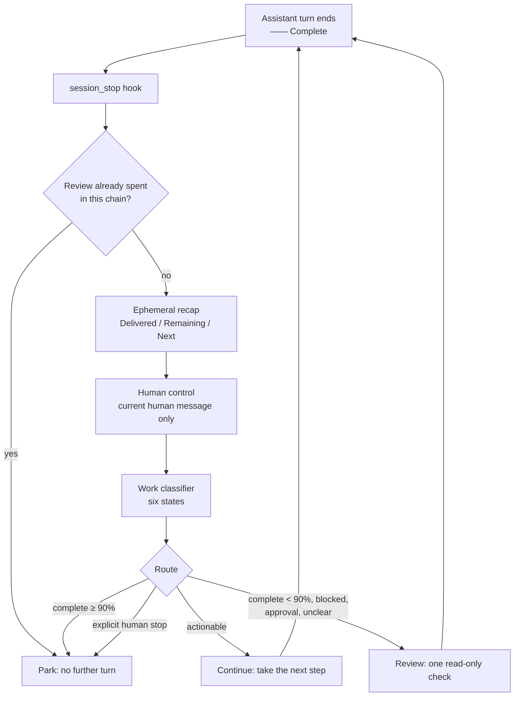

# prism-af

**Advisory completion gate for [OMP](https://github.com/can1357/oh-my-pi).** Every finished turn is checked by a local judge: is the work actually done, or did the assistant stop on a promise? If the evidence is thin, it asks for one more turn — then it stands down.

An ordinary extension factory registers the native `session_stop` hook. No queue, scheduler, provider transport, or chat integration is added. The gate never holds authority: it can ask the agent to look again, not to act.

- **Advisory, never authoritative.** A verdict routes a turn; it does not approve work, grant permission, or override a human stop.
- **Bounded by construction.** At most one evidence-review continuation per chain. Judge failure abstains instead of inventing a verdict.
- **Local.** Native recap + native `typesafe` judge, audited to a local JSONL file. No telemetry of its own.

<p align="center">
  
</p>

## What it looks like

A finished turn gets a verdict card; it retires to a single line once you continue.


## How it works



The marker is printed when the assistant stops, **before** the hook runs — so a continuation always appears after a turn that already looked finished.

## Decision contract

Two independent questions are asked. Neither one grants authority.

| Work state | Meaning |
| --- | --- |
| `actionable` | A concrete next step exists within existing permission. |
| `complete` | The requested outcome is delivered and no live commitment remains. |
| `blocked` | Useful work remains, but an observed external dependency prevents every permitted step. |
| `approval_required` | The only useful next step needs a genuinely new human decision. |
| `insufficient_evidence` | Missing or contradictory evidence; do not guess finished or blocked. |
| `stopped` | Human stop recorded separately; work classification is not used. |

| Route | Effect |
| --- | --- |
| `actionable` with human control `proceed` | One continuation asking for the next concrete action. |
| `complete` at ≥ 90% confidence | Park. |
| `complete` under 90%, `blocked`, `approval_required`, or unclear evidence | One review asking for a permitted read-only check. |
| Human stop | Park immediately; the work classifier is not consulted. |
| Pending input, cancellation, error, duplicate delivery | Suppressed; no stale continuation. |

**A bare acknowledgement cannot veto a confident completion.** "ok, thanks" reads as uncertain human control, which used to spend the review turn even on a 94%-confident complete — the bug that produced redundant "nothing else pending" turns. It now only matters when the work verdict is itself unresolved.

**Completion needs evidence, not a bare majority.** `complete` is accepted at ≥ 90% (`COMPLETE_CONFIDENCE`); anything in the 50–90% band gets one review (`routeReason: complete-uncertain`), because those verdicts usually meant remaining verification had not run.

## Install

```sh
omp plugin install github:JSRRosenbaum/prism-af#main
```

Local development:

```sh
git clone https://github.com/JSRRosenbaum/prism-af.git
omp plugin install ./prism-af
```

A local directory install is a **symlink**, not a release snapshot. The `omp.extensions` manifest loads `extensions/prism-af.ts`; do not also pass that entrypoint with `-e`, and do not keep another completion-gate registration. The historical `v0.1.0` tag predates the rename.

Start a fresh OMP process after installation, or use an orderly exact-session resume supported by your host. Package discovery, `/reload`, and `ctx.reload()` do not prove changed extension code is active.

Migrating from a loose `jev-completion-gate.ts`? Disable only that legacy module, leaving unrelated global registrations untouched:

```yaml
disabledExtensions:
  - extension-module:jev-completion-gate
```

The package entrypoint is `extension-module:prism-af`, so the legacy disable does not suppress it. Never install both undisabled — that gives future sessions two registrations.

For a session-only launch, OMP 18.12.5 resolves the package manifest through `--extension /absolute/path/to/package-directory`. Do **not** substitute `--plugin-dir`: that flag injects Claude/Agent plugin roots and does not load this native extension module.

### Native judge configuration

Use the existing `config.yml`, model registry, and credentials. Select the full provider/model identity of an already configured native `typesafe` judge:

```yaml
modelRoles:
  judge: your-provider/your-model
```

The plugin ships no provider, endpoint, key, or machine-specific default. Prompted chat/local-inference substitutes are not qualified. Missing configuration, a wrong resolved identity/API, unavailable internals, and backend errors all produce a warning plus a failed audit record — **no verdict, no continuation**. OMP keeps ownership of transport, cancellation, credentials, and usage accounting.

There is no bundled persona, standing exploration authorization, or system-prompt injection. Keep operator policy in your normal OMP instructions. Installing the plugin grants no authority.

## Cards and commands

| Command | Presentation |
| --- | --- |
| `/prism-af full` | Recap and detailed verdict cards (default). |
| `/prism-af collapse [--save]` | Result and probability share a ruled header; other results keep a two-line recap preview. |
| `/prism-af hidden` | No cards. Judging, auditing, and continuations continue. |

`/completion-cards` remains an alias. Changing modes redisplays the latest idle result without rejudging; `--save` persists `visibility` in `~/.omp/agent/extensions/completion-judge.json` (override with `JEV_COMPLETION_GATE_CONFIG`). `JEV_COMPLETION_GATE_VISIBILITY` takes precedence at startup.

Settled cards retire above the next prompt or continuation as a one-line notice — `─── Complete`, `─── Stopped`, `─── Approval required` — with no probability, route, or recap. Complete/Stopped are muted, Actionable uses the theme accent, review/wait states are amber, failures are red. Retirement uses UI notices, not conversation messages, so structured clients may show them as transient toasts.

## Audit and activation

Default audit: `~/.omp/agent/logs/jev-completion-gate.jsonl` (`JEV_COMPLETION_GATE_AUDIT_LOG` overrides). Records carry plugin/version, contract/prompt/policy versions, session/turn identity, input hashes and lengths, the decision, stage, effect, and route reason. Evidence text is not logged; provider diagnostics may appear in error reasons, so treat audit files as private. Directories/files are created `0700`/`0600`.

To prove activation, observe a **fresh record for the exact native session** with `plugin: "prism-af"` and the installed version. For `continue`/`review`, correlate a native `session-stop-continuation` entry with a subsequent real turn. A synthetic provider run qualifies mechanics only.

## Bounds and failure

| Evidence | Bound |
| --- | --- |
| Current human request | 8,000 characters; rejected intact if oversized |
| Terminal answer | 24,000 characters; rejected intact if oversized |
| Recent context | 4,000 characters, at most two messages per role |
| Fresh recap | 1–1,200 characters; no truncation or substitute |
| Recap deadline | 15 s |
| Two classifier calls | 28 s, inside the whole-gate budget |
| Entire gate | 29 s, below OMP's fixed 30 s handler cap |

Recent context prioritises complete human constraints, then tool observations, then assistant claims; oversized items are omitted whole with character metadata. Character budgets are not token guarantees — the recap's own input is session context supplied by OMP and is not bounded here, so a recap-side context error is a main-model failure, not a classifier one.

Failure cards name the stage and cause (`Recap context exceeded`, `Recap timed out`, `Judge unavailable`). No model window, output budget, compaction setting, retry, or continuation policy is changed by diagnostics.

## Compatibility

Targets **OMP 18.12.5**; other versions are unverified. The manifest pins host peer versions, and optional peers come from the running compiled host rather than a second runtime. Bun is needed for development tests only.

The plugin depends on internal OMP APIs: `settings`, `resolveJudge`/`journalJudgmentUsage`, the native `NativeJudge` client, and catalog cost calculation — used so completion calls get an explicit HTTP deadline instead of the role chain's fixed ten-second attempt. An incompatible upgrade causes explicit abstention, not a replacement verdict.

## Development

```sh
bun install --frozen-lockfile
bun test
npm pack --ignore-scripts --dry-run
```

The release allowlist holds ten files: entrypoint, five library modules, manifest, README, changelog, MIT license. Source tests live in GitHub but are excluded from the package. No install lifecycle scripts run. Never add private sessions, receipts, audit logs, credentials, or local policy to the repository.

Derived from a maintained native completion-gate implementation: decision contract v2, prompt v9, continuation policy v18, recap v2. Portable classifier `2026-10-21-portable-v1`, recap `2026-10-22-portable-v2`, continuation policy `2026-10-22-portable-v3`, decision contract `2026-10-20-v2`. Implementation and extraction were AI-assisted; finite mechanics tests do not establish broad semantic accuracy.

## License and credits

MIT — see [LICENSE](LICENSE). Artwork: Joseph Rosenbaum ([modelcitizens.jezzick.net](https://modelcitizens.jezzick.net)).
